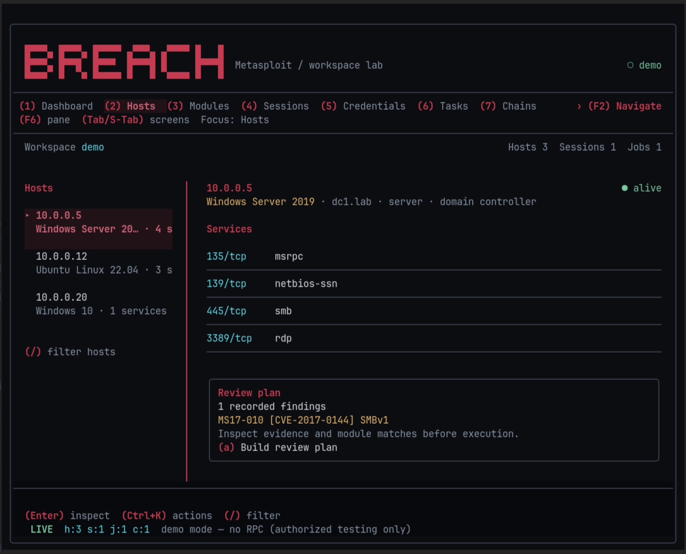

# Breach

Terminal frontend for [Metasploit Framework](https://github.com/rapid7/metasploit-framework). Drive `msfrpcd` from numbered tabs: hosts, modules, sessions, credentials, task chains, reports, an embedded console, and Pro-style wizards (auto-exploit *plan*, vulnerability checks, credential reuse, evidence macros, msfvenom).



This wraps Framework. It does not reimplement exploits, ship payloads, or talk to Rapid7 Metasploit Pro.

Only use against systems you own or have written permission to test.

## Install

```sh
curl -fsSL https://raw.githubusercontent.com/design-nexus/breach/main/install.sh | sh
```

From a clone (needs `cc`, e.g. `sudo apt-get install build-essential pkg-config`):

```sh
cargo install --path . --locked
```

Framework itself (required for live RPC; `--demo` works without it):

```sh
sudo apt install metasploit-framework    # Debian/Kali
msfdb init
```

## Usage

```sh
breach --demo          # sample workspace, no RPC
breach                 # connect to msfrpcd (Ctrl-G on Dash)
NEXUS_MSF_RPC_PASS=secret breach --host 127.0.0.1 --port 55553 --no-ssl
```

On first run a password is written to `~/.config/nexus-msf/config.toml` (mode `0600`). Spawned `msfrpcd` binds **127.0.0.1** only. Remote spawn is refused.

## Keys

| Key | Action |
|---|---|
| `1`–`9`, `0` | Dash / Hosts / Mods / Sess / Creds / Tasks / Chains / Reports / Console / Wizards |
| `Tab` / `Shift+Tab` | Next / previous screen |
| `F6` / `Shift+F6` | Next / previous pane |
| `F2` | Search screens, panes, and selectors |
| `Ctrl-G` | Primary action (connect, execute, discover, chain, report, plan) |
| `y` | Copy selection |
| `/` | Filter |
| `?` | Help |
| `q` | Quit |

Hosts: `a` auto-exploit plan, `i` import path. Modules: `t` type, `f` favorite, Enter option. Sessions: `i` interact. Wizards: `space` toggle plan item, `+/-` min rank, `v` check selected plan items. `Ctrl-V` checks the selected plan from the action palette; `Ctrl-X` cancels the active workflow. Tasks: `x` cancel, `PgUp/PgDn` scroll. Long confirmations also scroll with `PgUp/PgDn`.

## What this adds on top of Framework

Independent workflows, not Rapid7 Pro:

- Workspace dashboard and audit log
- Host / service / vuln browser + nmap/Nessus XML import (`db.import_data`)
- Module search, option editor, favorites, `module.execute`
- Session list, interact, stop, route display
- Credential + loot browser, reuse via login scanners
- Explainable auto-exploit **plan** (CVE/service/OS/rank) — nothing runs until you confirm
- Ordered task chains (TOML), failure policies, tracked jobs, and platform-aware evidence macros
- HTML/Markdown/JSON reports with full workspace evidence, validation results, and redaction
- msfvenom form (subprocess)
- Embedded msfconsole via `console.write` / `console.read`

Out of scope: phishing campaigns, Rapid7 exclusive modules, VPN pivoting, Pro APIs.

Chains wait for completion and refresh workspace data between operations. Matching uses the connected Framework's installed catalog. Validation runs supported `module.check` methods and saves their results. See [Pro-style workflows](docs/pro-workflows.md) for configuration, keys, failure policies, and verification limits.

## Theme

Crimson is the default theme. `Ctrl+K` offers theme selection, including Aurora, Follow Omarchy, and Terminal. Use a terminal with 24-bit color (`kitty`, `wezterm`, `ghostty`, recent `alacritty`).

## Data

```
~/.config/nexus-msf/config.toml
~/.local/share/nexus-msf/audit.jsonl
~/.local/share/nexus-msf/tasks.json
~/.local/share/nexus-msf/validations.json
~/.local/share/nexus-msf/cache/module-catalog.json
~/.local/share/nexus-msf/chains/*.toml
~/.local/share/nexus-msf/macros/*.toml
~/.local/share/nexus-msf/reports/<timestamp>-<workspace>/
```

## Interface

Existing explicit theme choices and legacy config/data locations are retained. `Ctrl+K` searches actions; Esc closes the palette. Actions use the same confirmations as their keyboard shortcuts. Tab / Shift+Tab changes screens; F6 / Shift+F6 changes panes. F2 opens Navigation. Details scroll with Page Up / Page Down. Narrow layouts show the active pane; the minimum terminal is 30×14.

Build requirements: Rust 1.88 or newer, Ratatui 0.30.2, Crossterm 0.29. Run `cargo test --locked` before `./install.sh`. The command is `breach`; no compatibility command aliases are installed.

See [shared navigation](docs/navigation.md) for keyboard and mouse controls.

Screenshots show actual Foot renders with sample data.

See [Crimson theme](docs/themes.md) for selection and verification details.
